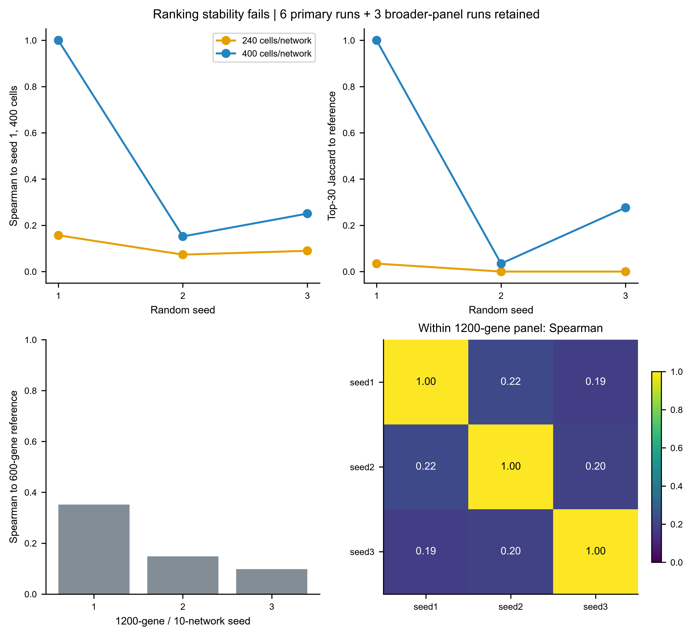

# 单细胞动力学与虚拟基因扰动方法库 / Single-cell dynamics and virtual perturbation

本仓库以真实公开数据和官方软件为基础，保存 scTenifoldKnk、Experimental OE 和 scTour 的独立分析流程、完整统计表、真实图件及中文解释。当前总体状态为 **PARTIAL**：KO/OE 软件运行已验证，但 KO 生物学排名不稳定；scTour 的 A20/B20 主模型已完成，A20 发育排序非单调，B 的剩余抽样模型仍在执行。运行状态以各模块报告为准，不能把 Smoke Test 当作论文复现。

An evidence-grounded collection of reproducible single-cell regulatory perturbation and dynamics workflows. Experimental outputs are computational hypotheses, not validated perturbation or lineage experiments.

## 方法入口 / Modules

| 模块 | 方法来源 | 入口 |
|---|---|---|
| 虚拟 KO | [官方 scTenifoldKnk](https://github.com/cailab-tamu/scTenifoldKnk) | [01_scTenifoldKnk](modules/01_scTenifoldKnk/README_CN.md) |
| 虚拟 OE（Experimental） | [第三方 virt_overexpression](https://github.com/virchow-zhang/virt_overexpression) | [02_scTenifoldOE](modules/02_scTenifoldOE/README_CN.md) |
| 动力学推断 | [官方 scTour](https://github.com/LiQian-XC/sctour) | [03_scTour](modules/03_scTour/README_CN.md) |

## 已执行结果 / Executed evidence

| 模块 | 数据与计算 | 状态及限制 |
|---|---|---|
| scTenifoldKnk | 官方100基因模拟示例；真实480个CD14+ Monocytes、600基因网络；SPI1、SPI1+CEBPB、9候选heat筛查、9组稳定性/敏感性、GO/KEGG/Reactome；11图 | `RUN_OK / PARTIAL`。不同seed及细胞抽样下排名不稳定，扩大1200基因/10网络后仍未改善，不能宣称稳健SPI1机制 |
| Experimental OE | 同一WT、SPI1、1/1.5/2/3强度、KO/OE共享与特异响应、三库富集；第三方原生API另行验证；10图 | `RUN_OK / PARTIAL`。同WT强度排序稳定，不等于跨WT或真实实验准确；上游pandas3错误已隔离；固定pandas2.2.3 |
| scTour | 原始GSE95315/GSE104323，论文对应4007/15174细胞；500/2000HVG；400epochs；官方模型重载及高维VF；主a–g/i与诊断图已输出 | `PARTIAL`。A20(seed0)与A90(seed0/1)均非单调；B20与B95排序相关0.9815，B1终末两阶段次序偏差保留；h与完整组合图待其余抽样模型完成 |

浏览 [真实图件画廊](gallery/FIGURE_INDEX_CN.md)，每张图均对应实际分析、输入表、独立绘图入口和 PNG/PDF/SVG。只调整图参数时读取结果重新绘制，不重跑网络或模型。



上图显示算法在本次小规模公开样本上的不稳定性；这是应保留的结果，不能通过挑seed隐藏。OE的剂量一致性只在同一WT网络下成立。

## 快速开始 / Quick start

先克隆 Private 仓库，进入仓库根目录。模型环境彼此独立；不要把 scTour 的旧版 Scanpy/Torch 与通用输入环境混装。

```powershell
git clone https://github.com/stevenhuangfannk-creator/single-cell-dynamics-perturbation.git
cd single-cell-dynamics-perturbation
python -m venv work/shared-env
work/shared-env/Scripts/python.exe -m pip install -r environments/shared-requirements.txt
work/shared-env/Scripts/python.exe -m unittest tests.test_input -v
```

1. 先按 [KO教程](modules/01_scTenifoldKnk/README_CN.md) 安装固定 R 包、下载/校验 PBMC counts、运行官方示例和公开样本。保留其 WT 和 KO 对象。
2. 再按 [OE教程](modules/02_scTenifoldOE/README_CN.md) 建立 Python 3.11/pandas2.2.3 环境，安装固定源码，复用同一WT开展比较。OE严格标记Experimental。
3. 按 [scTour教程](modules/03_scTour/README_CN.md) 配置 Python3.11/Torch2.5.1 CUDA或CPU，下载GEO counts与metadata，先Smoke再400epoch正式模型、子抽样及独立绘图。

原始下载、校验值与筛选规则见 [数据登记](data_registry/)，文献见 [参考文献](docs/REFERENCES.md)，硬件见 [资源记录](reports/hardware.json)。新 PI/Healthy 输入只做 [数据格式与设计审查](docs/INPUT_AND_PI_CN.md)；尚未分析用户私有数据。

单图例子（在对应已安装环境、仓库根目录运行）：

```powershell
python modules/01_scTenifoldKnk/scripts/plot_figures.py --figure 10 --dpi 600
python modules/02_scTenifoldOE/scripts/plot_oe.py --figure 05 --dpi 600
```

scTour图g读取保存的 `inferred.h5ad`，修改 `config/plot.json` 后调用 `plot_figure2.py --panel g`；完整命令见模块教程。源数据与模型是本地对象，首次克隆后须先重建，不能只靠图像恢复动力学。

## 目录与复建 / Repository layout

`modules/` 保存三个方法各自配置、脚本、对象说明、结果、图件、报告；`shared/` 保存counts审查、Seurat导出和PI入口；`data_registry/` 保存下载证据；`environments/` 保存实际环境与安装；`tests/` 与 `.github/workflows/` 验证输入和代码；`gallery/` 为图件索引；`reports/` 为统一验证记录。

本机验证为 Windows 11、R 4.3.1、Python 3.13通用输入环境、Python 3.11模型环境、RTX4070 Laptop GPU 8GB、15.69GiB内存。scTour官方ODE部分仍在CPU；训练耗时以实际日志为准。CPU入口已提供，全部正式模型的CPU重训未完成，不能把GPU结果描述为CPU验证。

GitHub轻量CI检查输入、保存的KO/OE结果不变量、画廊路径及源码编译，不下载完整GEO，也不代表科学结果复现。`shared.lock.txt`记录本机版本，含安装器本地路径，仅供追溯；新建共享环境使用`shared-requirements.txt`。`RUN_OK`、`REPRODUCED`、`PARTIAL`、`BLOCKED` 的定义见 [方法比较与状态说明](docs/METHOD_COMPARISON_CN.md)。

## 科学边界 / Interpretation

scTenifoldKnk 的网络扰动距离、FC 与统计显著性不等于真实表达差异。OE 网络增强倍数不等于 mRNA 过表达倍数。scTour 可使用表达矩阵而不要求 spliced/unspliced，但静态表达中的动力学预测不能直接证明真实谱系转化。PI 与 Healthy 的分组不是时间顺序。

大型原始数据、AnnData、模型及中间对象不上传 Git；通过数据登记、固定配置和下载/运行脚本重建。小型结果表、真实图件及日志可纳入版本管理。
