# 真实图件索引 / Figure gallery

每张预览均来自保存的计算结果。图中距离、时间或网络倍数须按对应方法说明解释；没有实际结果的面板不以示意图填充。单图重绘只读取结果对象，不重新训练模型。

| 编号、方法与代码入口 | 数据、科学含义与状态 | 真实图件预览及导出 |
|---|---|---|
| **Knk-01 · WT调控网络（显示子图）** scTenifoldKnk [分析](../modules/01_scTenifoldKnk/scripts/run_pbmc.R) · [重绘](../modules/01_scTenifoldKnk/scripts/plot_figures.py) <code>python modules/01_scTenifoldKnk/scripts/plot_figures.py --figure 01</code> [参考来源](https://doi.org/10.1016/j.patter.2022.100434) | 10x PBMC3k, 480 CD14+ monocytes, 600 selected genes 显示WT的强权重PCR网络关联，不能据边符号认定真实激活或抑制。 **RUN_OK / PARTIAL**：真实计算输出；seed/subsample稳定性差，探索性候选结果，未实验验证。 | 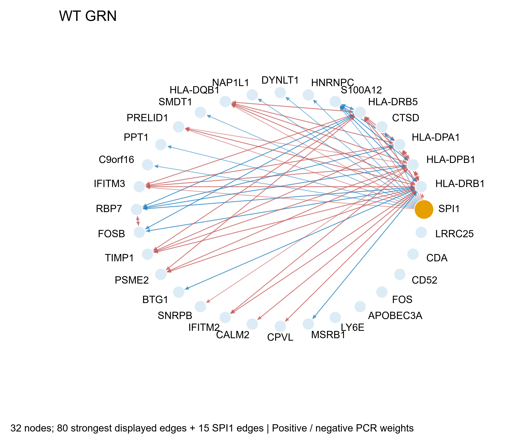 [PNG](../modules/01_scTenifoldKnk/figures/Knk_Figure01.png) · [PDF](../modules/01_scTenifoldKnk/figures/Knk_Figure01.pdf) · [SVG](../modules/01_scTenifoldKnk/figures/Knk_Figure01.svg) |
| **Knk-02 · SPI1虚拟敲除网络** scTenifoldKnk [分析](../modules/01_scTenifoldKnk/scripts/run_pbmc.R) · [重绘](../modules/01_scTenifoldKnk/scripts/plot_figures.py) <code>python modules/01_scTenifoldKnk/scripts/plot_figures.py --figure 02</code> [参考来源](https://doi.org/10.1016/j.patter.2022.100434) | 10x PBMC3k, 480 CD14+ monocytes, 600 selected genes 与WT共用布局，SPI1行出边归零，其他边保持一致。 **RUN_OK / PARTIAL**：真实计算输出；seed/subsample稳定性差，探索性候选结果，未实验验证。 | 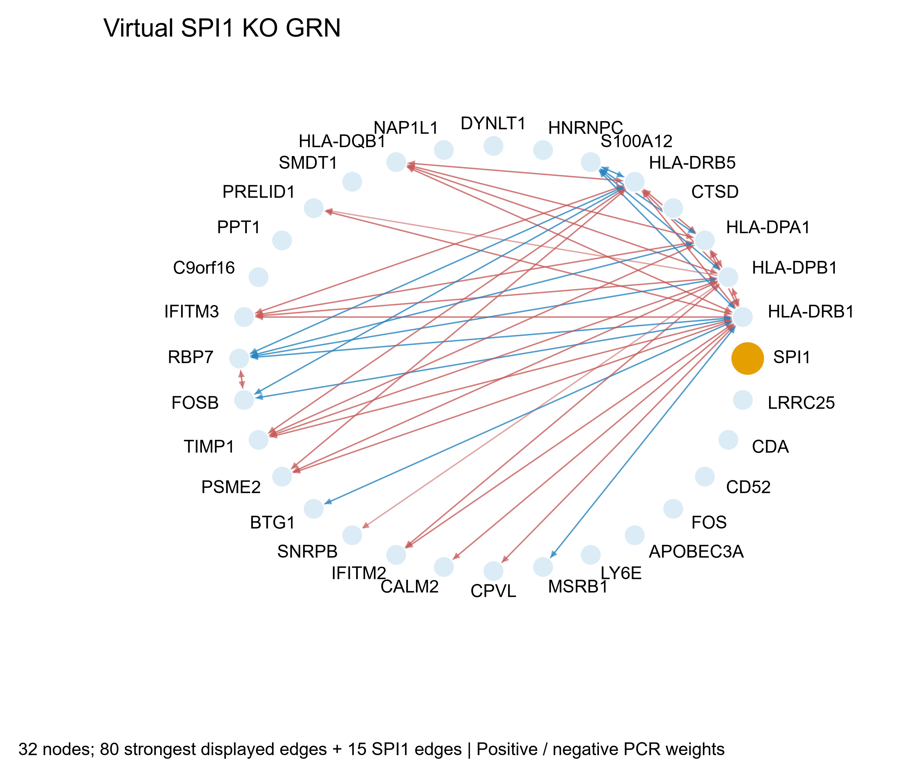 [PNG](../modules/01_scTenifoldKnk/figures/Knk_Figure02.png) · [PDF](../modules/01_scTenifoldKnk/figures/Knk_Figure02.pdf) · [SVG](../modules/01_scTenifoldKnk/figures/Knk_Figure02.svg) |
| **Knk-03 · WT与KO网络比较** scTenifoldKnk [分析](../modules/01_scTenifoldKnk/scripts/run_pbmc.R) · [重绘](../modules/01_scTenifoldKnk/scripts/plot_figures.py) <code>python modules/01_scTenifoldKnk/scripts/plot_figures.py --figure 03</code> [参考来源](https://doi.org/10.1016/j.patter.2022.100434) | 10x PBMC3k, 480 CD14+ monocytes, 600 selected genes 核对SPI1出边被移除且其他行不变；网络结构变化由算法定义。 **RUN_OK / PARTIAL**：真实计算输出；seed/subsample稳定性差，探索性候选结果，未实验验证。 | 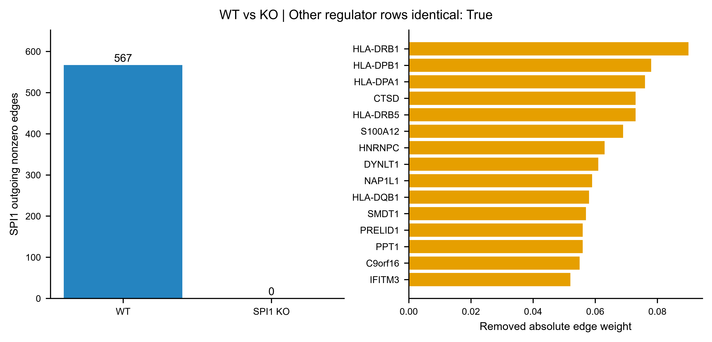 [PNG](../modules/01_scTenifoldKnk/figures/Knk_Figure03.png) · [PDF](../modules/01_scTenifoldKnk/figures/Knk_Figure03.pdf) · [SVG](../modules/01_scTenifoldKnk/figures/Knk_Figure03.svg) |
| **Knk-04 · 差异调控扰动排序** scTenifoldKnk [分析](../modules/01_scTenifoldKnk/scripts/run_pbmc.R) · [重绘](../modules/01_scTenifoldKnk/scripts/plot_figures.py) <code>python modules/01_scTenifoldKnk/scripts/plot_figures.py --figure 04</code> [参考来源](https://doi.org/10.1016/j.patter.2022.100434) | 10x PBMC3k, 480 CD14+ monocytes, 600 selected genes 非target基因按WT–KO manifold distance排序，颜色仅为官方另算的方向预测。 **RUN_OK / PARTIAL**：真实计算输出；seed/subsample稳定性差，探索性候选结果，未实验验证。 | 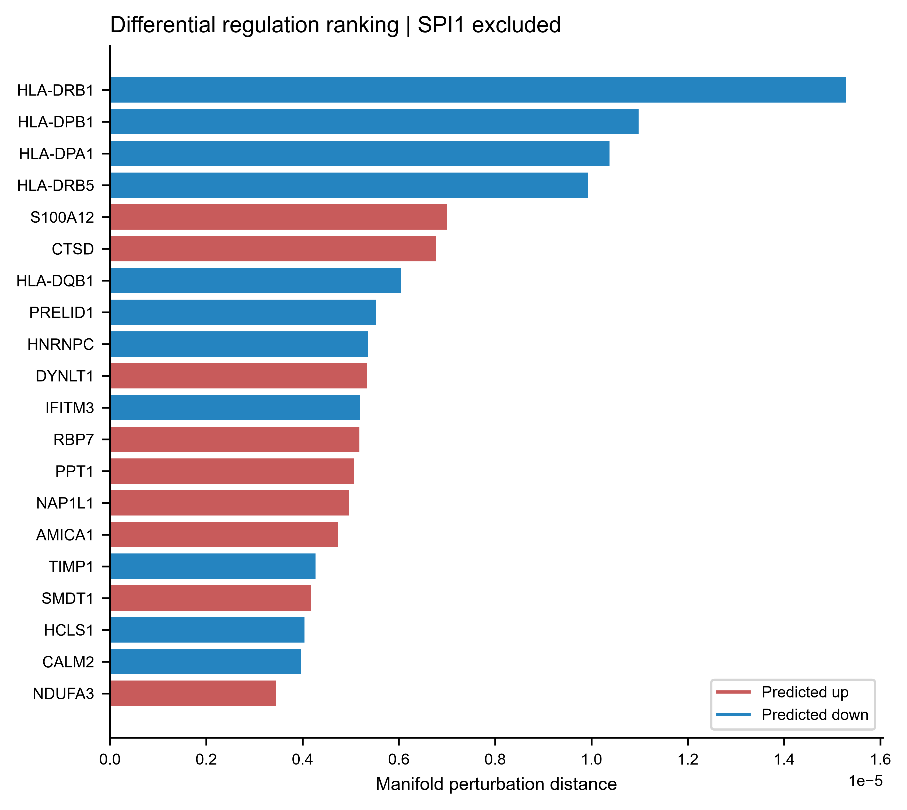 [PNG](../modules/01_scTenifoldKnk/figures/Knk_Figure04.png) · [PDF](../modules/01_scTenifoldKnk/figures/Knk_Figure04.pdf) · [SVG](../modules/01_scTenifoldKnk/figures/Knk_Figure04.svg) |
| **Knk-05 · 扰动统计显著性** scTenifoldKnk [分析](../modules/01_scTenifoldKnk/scripts/run_pbmc.R) · [重绘](../modules/01_scTenifoldKnk/scripts/plot_figures.py) <code>python modules/01_scTenifoldKnk/scripts/plot_figures.py --figure 05</code> [参考来源](https://doi.org/10.1016/j.patter.2022.100434) | 10x PBMC3k, 480 CD14+ monocytes, 600 selected genes 距离与BH调整p值的关系；按构建必然变化的SPI1 target已排除。 **RUN_OK / PARTIAL**：真实计算输出；seed/subsample稳定性差，探索性候选结果，未实验验证。 | 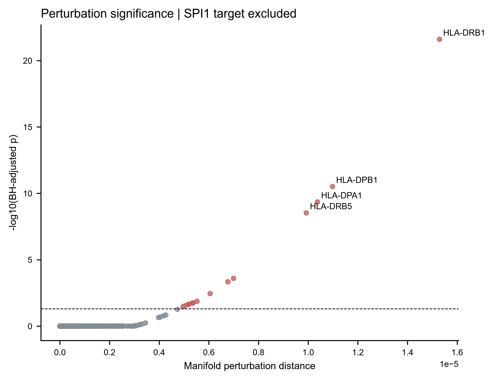 [PNG](../modules/01_scTenifoldKnk/figures/Knk_Figure05.png) · [PDF](../modules/01_scTenifoldKnk/figures/Knk_Figure05.pdf) · [SVG](../modules/01_scTenifoldKnk/figures/Knk_Figure05.svg) |
| **Knk-06 · SPI1中心调控网络** scTenifoldKnk [分析](../modules/01_scTenifoldKnk/scripts/run_pbmc.R) · [重绘](../modules/01_scTenifoldKnk/scripts/plot_figures.py) <code>python modules/01_scTenifoldKnk/scripts/plot_figures.py --figure 06</code> [参考来源](https://doi.org/10.1016/j.patter.2022.100434) | 10x PBMC3k, 480 CD14+ monocytes, 600 selected genes SPI1出边中绝对权重最大的16个邻居；边权是模型关联而非实验证实调控。 **RUN_OK / PARTIAL**：真实计算输出；seed/subsample稳定性差，探索性候选结果，未实验验证。 | 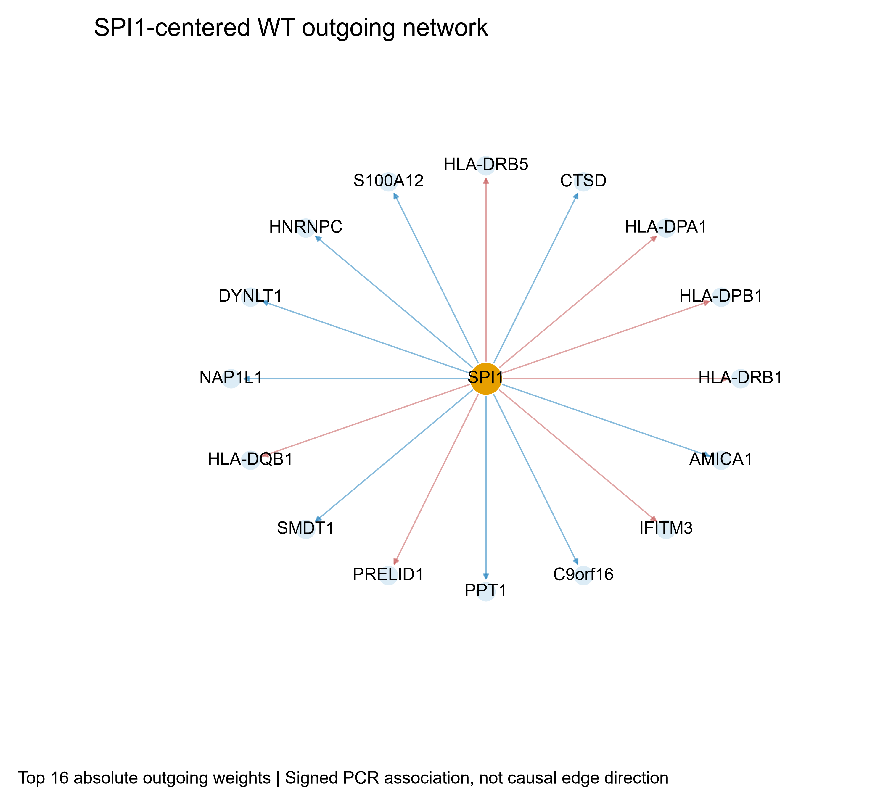 [PNG](../modules/01_scTenifoldKnk/figures/Knk_Figure06.png) · [PDF](../modules/01_scTenifoldKnk/figures/Knk_Figure06.pdf) · [SVG](../modules/01_scTenifoldKnk/figures/Knk_Figure06.svg) |
| **Knk-07 · GO/KEGG/Reactome富集** scTenifoldKnk [分析](../modules/01_scTenifoldKnk/scripts/enrich.py) · [重绘](../modules/01_scTenifoldKnk/scripts/plot_figures.py) <code>python modules/01_scTenifoldKnk/scripts/plot_figures.py --figure 07</code> [参考来源](https://doi.org/10.1016/j.patter.2022.100434) | 10x PBMC3k, 480 CD14+ monocytes, 600 selected genes 非target BH<0.05响应基因在600个测量网络基因背景上的超几何富集。 **RUN_OK / PARTIAL**：真实计算输出；seed/subsample稳定性差，探索性候选结果，未实验验证。 | 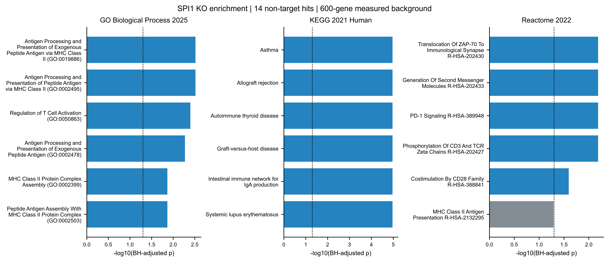 [PNG](../modules/01_scTenifoldKnk/figures/Knk_Figure07.png) · [PDF](../modules/01_scTenifoldKnk/figures/Knk_Figure07.pdf) · [SVG](../modules/01_scTenifoldKnk/figures/Knk_Figure07.svg) |
| **Knk-08 · 候选KO网络扰动热图** scTenifoldKnk [分析](../modules/01_scTenifoldKnk/scripts/run_pbmc.R) · [重绘](../modules/01_scTenifoldKnk/scripts/plot_figures.py) <code>python modules/01_scTenifoldKnk/scripts/plot_figures.py --figure 08</code> [参考来源](https://doi.org/10.1016/j.patter.2022.100434) | 10x PBMC3k, 480 CD14+ monocytes, 600 selected genes 9个候选分别KO的官方heat distance，颜色是行内标准化log1p距离，无表达方向。 **RUN_OK / PARTIAL**：真实计算输出；seed/subsample稳定性差，探索性候选结果，未实验验证。 | 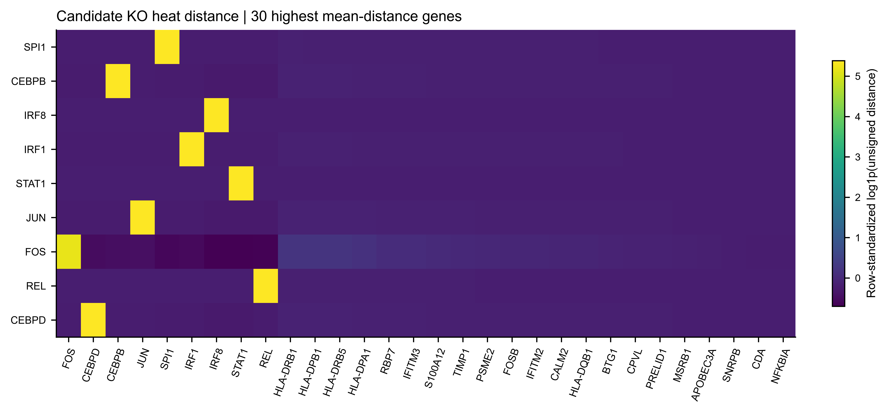 [PNG](../modules/01_scTenifoldKnk/figures/Knk_Figure08.png) · [PDF](../modules/01_scTenifoldKnk/figures/Knk_Figure08.pdf) · [SVG](../modules/01_scTenifoldKnk/figures/Knk_Figure08.svg) |
| **Knk-09 · 单基因与联合KO响应比较** scTenifoldKnk [分析](../modules/01_scTenifoldKnk/scripts/run_pbmc.R) · [重绘](../modules/01_scTenifoldKnk/scripts/plot_figures.py) <code>python modules/01_scTenifoldKnk/scripts/plot_figures.py --figure 09</code> [参考来源](https://doi.org/10.1016/j.patter.2022.100434) | 10x PBMC3k, 480 CD14+ monocytes, 600 selected genes 在相同WT上比较SPI1单KO与SPI1+CEBPB联合KO的manifold distance。 **RUN_OK / PARTIAL**：真实计算输出；seed/subsample稳定性差，探索性候选结果，未实验验证。 | 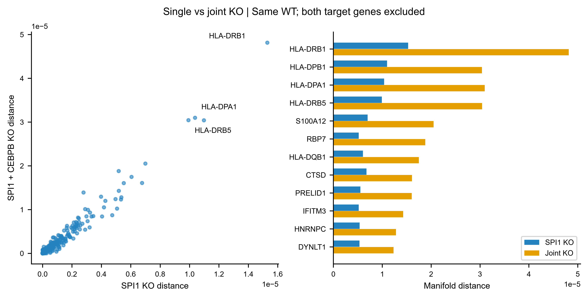 [PNG](../modules/01_scTenifoldKnk/figures/Knk_Figure09.png) · [PDF](../modules/01_scTenifoldKnk/figures/Knk_Figure09.pdf) · [SVG](../modules/01_scTenifoldKnk/figures/Knk_Figure09.svg) |
| **Knk-10 · 随机种子和细胞抽样稳定性** scTenifoldKnk [分析1](../modules/01_scTenifoldKnk/scripts/run_pbmc.R) · [分析2](../modules/01_scTenifoldKnk/scripts/run_sensitivity.R) · [重绘](../modules/01_scTenifoldKnk/scripts/plot_figures.py) <code>python modules/01_scTenifoldKnk/scripts/plot_figures.py --figure 10</code> [参考来源](https://doi.org/10.1016/j.patter.2022.100434) | 10x PBMC3k, 480 CD14+ monocytes, 600 selected genes; 1200-gene sensitivity 600gene的6组种子/抽样与1200gene/10nets的3组敏感性均排名不稳定，不能据主seed宣称可靠机制。 **RUN_OK / PARTIAL**：真实计算输出；seed/subsample稳定性差，探索性候选结果，未实验验证。 |  [PNG](../modules/01_scTenifoldKnk/figures/Knk_Figure10.png) · [PDF](../modules/01_scTenifoldKnk/figures/Knk_Figure10.pdf) · [SVG](../modules/01_scTenifoldKnk/figures/Knk_Figure10.svg) |
| **Knk-11 · 候选扰动图（内部参考）** scTenifoldKnk [分析](../modules/01_scTenifoldKnk/scripts/run_pbmc.R) · [重绘](../modules/01_scTenifoldKnk/scripts/plot_figures.py) <code>python modules/01_scTenifoldKnk/scripts/plot_figures.py --figure 11</code> [参考来源](https://doi.org/10.1016/j.patter.2022.100434) | 10x PBMC3k, 480 CD14+ monocytes, 600 selected genes 官方perturbationMap坐标；与同一模型SPI1 signed heat-KO内部参考的相似性，非疾病签名，只有9候选。 **RUN_OK / PARTIAL**：真实计算输出；seed/subsample稳定性差，探索性候选结果，未实验验证。 | 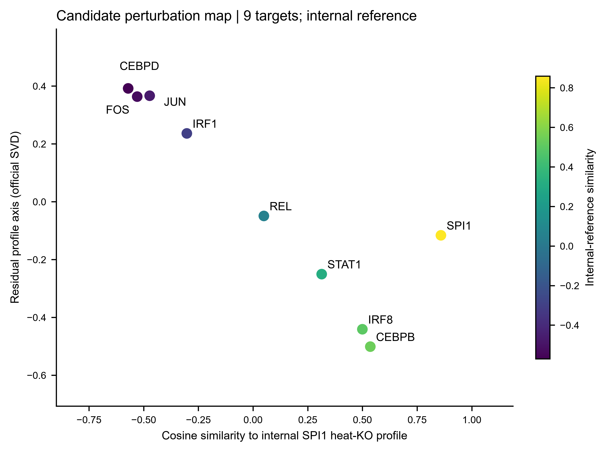 [PNG](../modules/01_scTenifoldKnk/figures/Knk_Figure11.png) · [PDF](../modules/01_scTenifoldKnk/figures/Knk_Figure11.pdf) · [SVG](../modules/01_scTenifoldKnk/figures/Knk_Figure11.svg) |
| **OE_01 · 虚拟过表达网络** Experimental: virt_overexpression 0.1.0 (virchow-zhang) + official R manifold/DR [分析](../modules/02_scTenifoldOE/scripts/run_oe.py) · [重绘](../modules/02_scTenifoldOE/scripts/plot_oe.py) <code>& ./work/oe-env/Scripts/python.exe ./modules/02_scTenifoldOE/scripts/plot_oe.py --figure 01 --dpi 600</code> [参考来源](https://github.com/virchow-zhang/virt_overexpression/tree/860d0ea59dc0aeb564a286efae00f562ce84e138) | 10x PBMC3k; CD14+ Monocytes; 600 genes × 480 cells; shared Knk WT; SPI1 固定布局，靶点边优先并补最强关联边，共最多70边；颜色表示PC回归权重符号，非真实因果激活/抑制。 **RUN_OK**：Experimental网络模拟；同一WT，无实验生物学重复；distance不含表达方向，非真实mRNA/CRISPR预测。 | 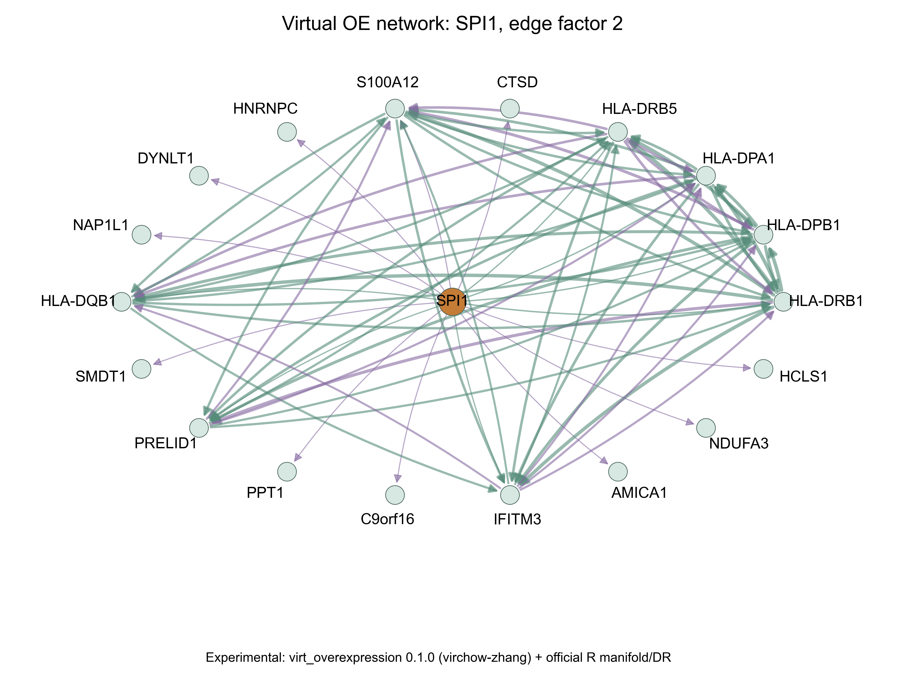 [PNG](../modules/02_scTenifoldOE/figures/OE_Figure01_Virtual_OE_Network.png) · [PDF](../modules/02_scTenifoldOE/figures/OE_Figure01_Virtual_OE_Network.pdf) · [SVG](../modules/02_scTenifoldOE/figures/OE_Figure01_Virtual_OE_Network.svg) |
| **OE_02 · WT与OE网络差异** Experimental: virt_overexpression 0.1.0 (virchow-zhang) + official R manifold/DR [分析](../modules/02_scTenifoldOE/scripts/run_oe.py) · [重绘](../modules/02_scTenifoldOE/scripts/plot_oe.py) <code>& ./work/oe-env/Scripts/python.exe ./modules/02_scTenifoldOE/scripts/plot_oe.py --figure 02 --dpi 600</code> [参考来源](https://github.com/virchow-zhang/virt_overexpression/tree/860d0ea59dc0aeb564a286efae00f562ce84e138) | 10x PBMC3k; CD14+ Monocytes; 600 genes × 480 cells; shared Knk WT; SPI1 仅SPI1行的正出边增强；负边及其他基因边权原样保留。 **RUN_OK**：Experimental网络模拟；同一WT，无实验生物学重复；distance不含表达方向，非真实mRNA/CRISPR预测。 | 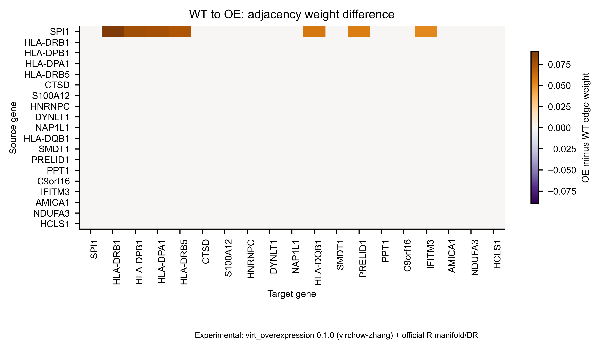 [PNG](../modules/02_scTenifoldOE/figures/OE_Figure02_Network_Difference.png) · [PDF](../modules/02_scTenifoldOE/figures/OE_Figure02_Network_Difference.pdf) · [SVG](../modules/02_scTenifoldOE/figures/OE_Figure02_Network_Difference.svg) |
| **OE_03 · OE扰动响应排序** Experimental: virt_overexpression 0.1.0 (virchow-zhang) + official R manifold/DR [分析](../modules/02_scTenifoldOE/scripts/run_oe.py) · [重绘](../modules/02_scTenifoldOE/scripts/plot_oe.py) <code>& ./work/oe-env/Scripts/python.exe ./modules/02_scTenifoldOE/scripts/plot_oe.py --figure 03 --dpi 600</code> [参考来源](https://github.com/virchow-zhang/virt_overexpression/tree/860d0ea59dc0aeb564a286efae00f562ce84e138) | 10x PBMC3k; CD14+ Monocytes; 600 genes × 480 cells; shared Knk WT; SPI1 按无方向manifold距离排序，排除靶点；绿色FDR<0.05，灰色非显著。 **RUN_OK**：Experimental网络模拟；同一WT，无实验生物学重复；distance不含表达方向，非真实mRNA/CRISPR预测。 | 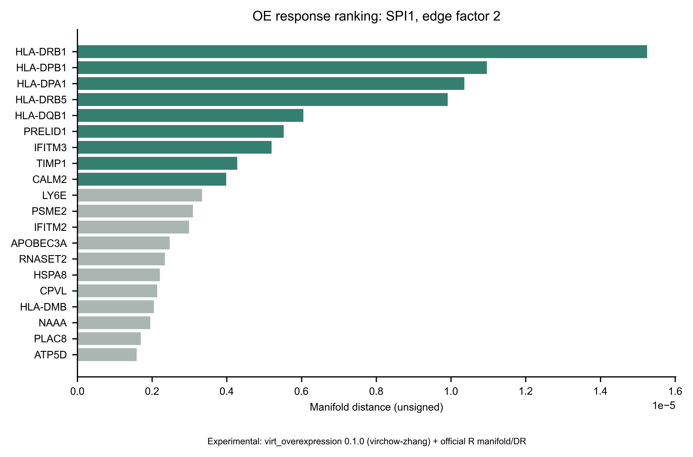 [PNG](../modules/02_scTenifoldOE/figures/OE_Figure03_Perturbation_Ranking.png) · [PDF](../modules/02_scTenifoldOE/figures/OE_Figure03_Perturbation_Ranking.pdf) · [SVG](../modules/02_scTenifoldOE/figures/OE_Figure03_Perturbation_Ranking.svg) |
| **OE_04 · SPI1中心调控网络** Experimental: virt_overexpression 0.1.0 (virchow-zhang) + official R manifold/DR [分析](../modules/02_scTenifoldOE/scripts/run_oe.py) · [重绘](../modules/02_scTenifoldOE/scripts/plot_oe.py) <code>& ./work/oe-env/Scripts/python.exe ./modules/02_scTenifoldOE/scripts/plot_oe.py --figure 04 --dpi 600</code> [参考来源](https://github.com/virchow-zhang/virt_overexpression/tree/860d0ea59dc0aeb564a286efae00f562ce84e138) | 10x PBMC3k; CD14+ Monocytes; 600 genes × 480 cells; shared Knk WT; SPI1 显示预先指定靶点的最强18个出边邻居；模型权重是回归关联。 **RUN_OK**：Experimental网络模拟；同一WT，无实验生物学重复；distance不含表达方向，非真实mRNA/CRISPR预测。 | 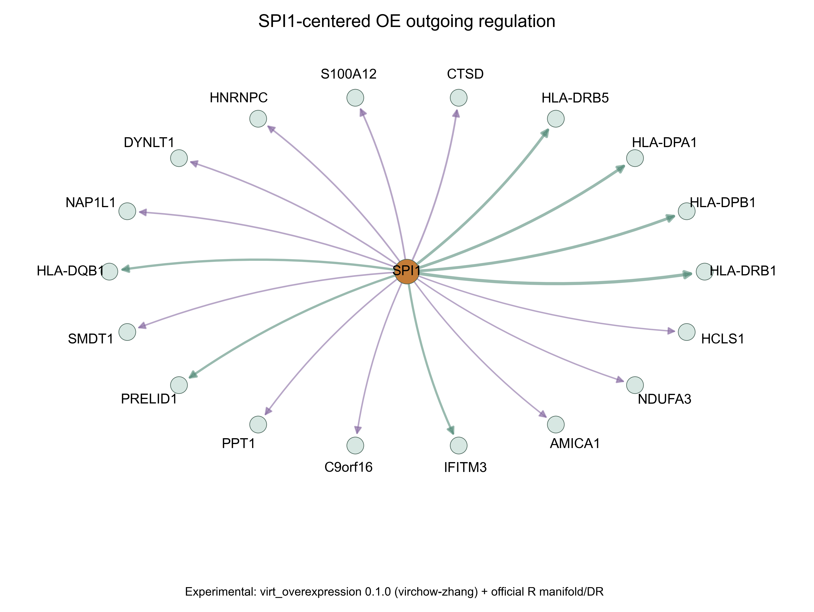 [PNG](../modules/02_scTenifoldOE/figures/OE_Figure04_Regulatory_Network.png) · [PDF](../modules/02_scTenifoldOE/figures/OE_Figure04_Regulatory_Network.pdf) · [SVG](../modules/02_scTenifoldOE/figures/OE_Figure04_Regulatory_Network.svg) |
| **OE_05 · 过表达强度敏感性** Experimental: virt_overexpression 0.1.0 (virchow-zhang) + official R manifold/DR [分析](../modules/02_scTenifoldOE/scripts/run_oe.py) · [重绘](../modules/02_scTenifoldOE/scripts/plot_oe.py) <code>& ./work/oe-env/Scripts/python.exe ./modules/02_scTenifoldOE/scripts/plot_oe.py --figure 05 --dpi 600</code> [参考来源](https://github.com/virchow-zhang/virt_overexpression/tree/860d0ea59dc0aeb564a286efae00f562ce84e138) | 10x PBMC3k; CD14+ Monocytes; 600 genes × 480 cells; shared Knk WT; SPI1 同一WT下网络剂量与响应的敏感性；单次WT，无重复误差条，不等于mRNA倍数。 **RUN_OK**：Experimental网络模拟；同一WT，无实验生物学重复；distance不含表达方向，非真实mRNA/CRISPR预测。 | 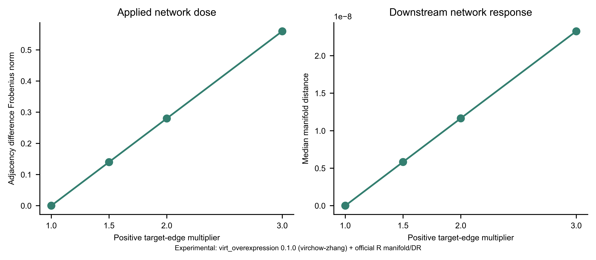 [PNG](../modules/02_scTenifoldOE/figures/OE_Figure05_Strength_Sensitivity.png) · [PDF](../modules/02_scTenifoldOE/figures/OE_Figure05_Strength_Sensitivity.pdf) · [SVG](../modules/02_scTenifoldOE/figures/OE_Figure05_Strength_Sensitivity.svg) |
| **OE_06 · KO与OE扰动比较** Experimental: virt_overexpression 0.1.0 (virchow-zhang) + official R manifold/DR [分析](../modules/02_scTenifoldOE/scripts/run_oe.py) · [重绘](../modules/02_scTenifoldOE/scripts/plot_oe.py) <code>& ./work/oe-env/Scripts/python.exe ./modules/02_scTenifoldOE/scripts/plot_oe.py --figure 06 --dpi 600</code> [参考来源](https://github.com/virchow-zhang/virt_overexpression/tree/860d0ea59dc0aeb564a286efae00f562ce84e138) | 10x PBMC3k; CD14+ Monocytes; 600 genes × 480 cells; shared Knk WT; SPI1 相同WT、靶点、MA维数和统计规则；比较无方向距离，相关性不证明相反调控。 **RUN_OK**：Experimental网络模拟；同一WT，无实验生物学重复；distance不含表达方向，非真实mRNA/CRISPR预测。 | 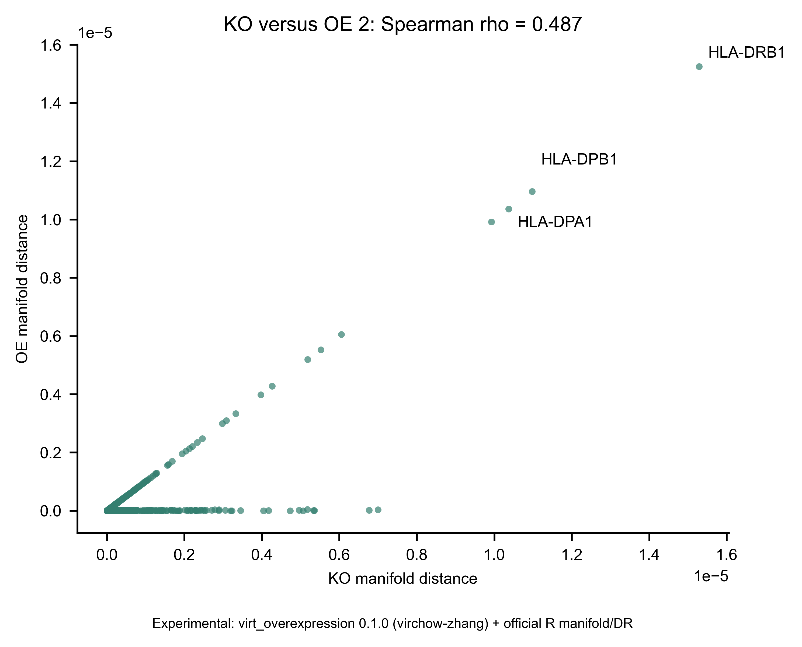 [PNG](../modules/02_scTenifoldOE/figures/OE_Figure06_KO_OE_Comparison.png) · [PDF](../modules/02_scTenifoldOE/figures/OE_Figure06_KO_OE_Comparison.pdf) · [SVG](../modules/02_scTenifoldOE/figures/OE_Figure06_KO_OE_Comparison.svg) |
| **OE_07 · KO/OE共享与特异响应** Experimental: virt_overexpression 0.1.0 (virchow-zhang) + official R manifold/DR [分析](../modules/02_scTenifoldOE/scripts/run_oe.py) · [重绘](../modules/02_scTenifoldOE/scripts/plot_oe.py) <code>& ./work/oe-env/Scripts/python.exe ./modules/02_scTenifoldOE/scripts/plot_oe.py --figure 07 --dpi 600</code> [参考来源](https://github.com/virchow-zhang/virt_overexpression/tree/860d0ea59dc0aeb564a286efae00f562ce84e138) | 10x PBMC3k; CD14+ Monocytes; 600 genes × 480 cells; shared Knk WT; SPI1 共享/特异取决于当前WT与FDR阈值，空集合如实显示，未显著不等于无生物学作用。 **RUN_OK**：Experimental网络模拟；同一WT，无实验生物学重复；distance不含表达方向，非真实mRNA/CRISPR预测。 | 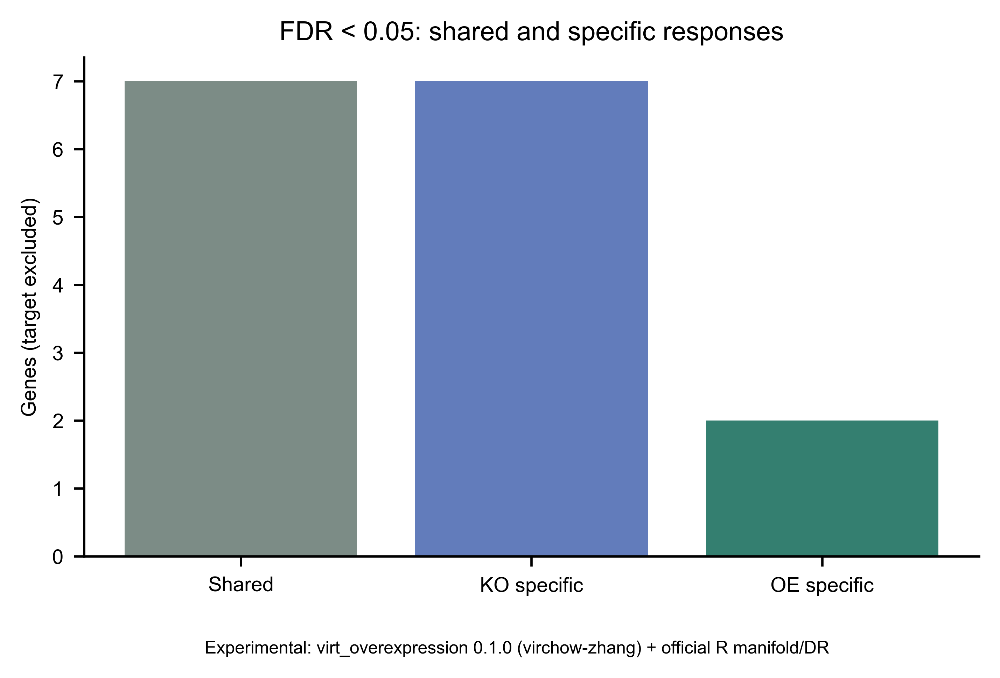 [PNG](../modules/02_scTenifoldOE/figures/OE_Figure07_Shared_Specific_Responses.png) · [PDF](../modules/02_scTenifoldOE/figures/OE_Figure07_Shared_Specific_Responses.pdf) · [SVG](../modules/02_scTenifoldOE/figures/OE_Figure07_Shared_Specific_Responses.svg) |
| **OE_08 · KO/OE通路富集** Experimental: virt_overexpression 0.1.0 (virchow-zhang) + official R manifold/DR [分析](../modules/02_scTenifoldOE/scripts/enrich_compare.py) · [重绘](../modules/02_scTenifoldOE/scripts/plot_oe.py) <code>& ./work/oe-env/Scripts/python.exe ./modules/02_scTenifoldOE/scripts/plot_oe.py --figure 08 --dpi 600</code> [参考来源](https://github.com/virchow-zhang/virt_overexpression/tree/860d0ea59dc0aeb564a286efae00f562ce84e138) | 10x PBMC3k; CD14+ Monocytes; 600 genes × 480 cells; shared Knk WT; SPI1 ORA背景为当前网络所有非靶基因；按集合与数据库内BH校正，虚线q=0.05；名称换行保留完整术语，仅省略末尾Reactome R-HSA编号，完整ID见结果表。 **RUN_OK**：Experimental网络模拟；同一WT，无实验生物学重复；distance不含表达方向，非真实mRNA/CRISPR预测。 | 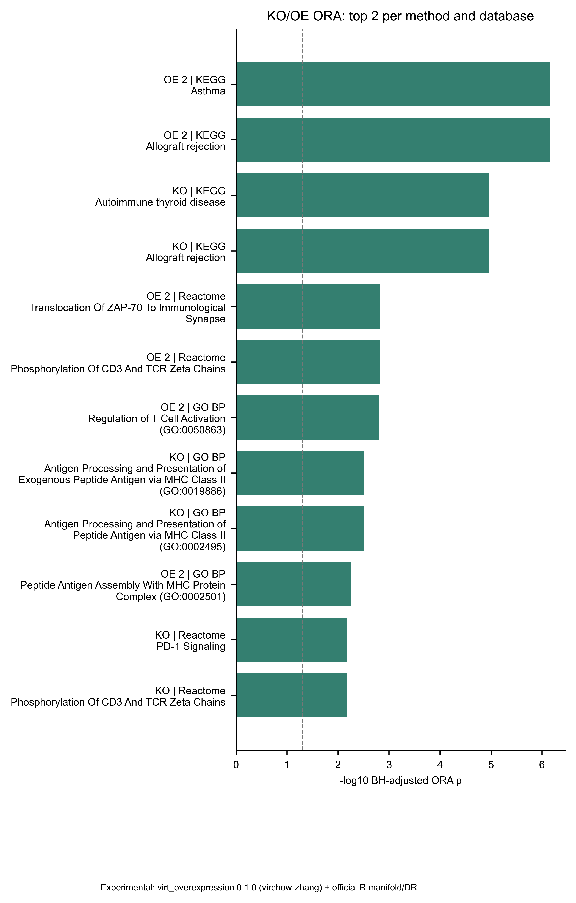 [PNG](../modules/02_scTenifoldOE/figures/OE_Figure08_Pathway_Enrichment.png) · [PDF](../modules/02_scTenifoldOE/figures/OE_Figure08_Pathway_Enrichment.pdf) · [SVG](../modules/02_scTenifoldOE/figures/OE_Figure08_Pathway_Enrichment.svg) |
| **OE_09 · 不同强度响应热图** Experimental: virt_overexpression 0.1.0 (virchow-zhang) + official R manifold/DR [分析](../modules/02_scTenifoldOE/scripts/run_oe.py) · [重绘](../modules/02_scTenifoldOE/scripts/plot_oe.py) <code>& ./work/oe-env/Scripts/python.exe ./modules/02_scTenifoldOE/scripts/plot_oe.py --figure 09 --dpi 600</code> [参考来源](https://github.com/virchow-zhang/virt_overexpression/tree/860d0ea59dc0aeb564a286efae00f562ce84e138) | 10x PBMC3k; CD14+ Monocytes; 600 genes × 480 cells; shared Knk WT; SPI1 相同基因在强度1/1.5/2/3下的实际无方向距离；未逐行标准化。 **RUN_OK**：Experimental网络模拟；同一WT，无实验生物学重复；distance不含表达方向，非真实mRNA/CRISPR预测。 | 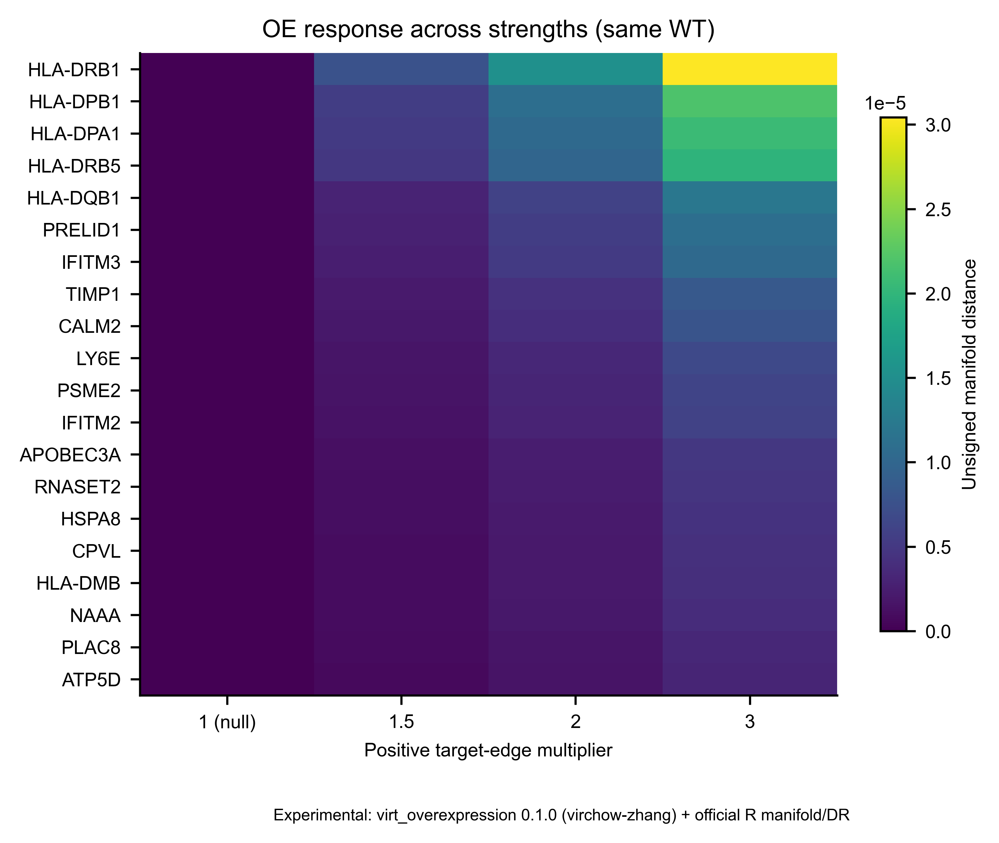 [PNG](../modules/02_scTenifoldOE/figures/OE_Figure09_Response_Heatmap.png) · [PDF](../modules/02_scTenifoldOE/figures/OE_Figure09_Response_Heatmap.pdf) · [SVG](../modules/02_scTenifoldOE/figures/OE_Figure09_Response_Heatmap.svg) |
| **OE_10 · 三状态调控网络景观** Experimental: virt_overexpression 0.1.0 (virchow-zhang) + official R manifold/DR [分析](../modules/02_scTenifoldOE/scripts/run_oe.py) · [重绘](../modules/02_scTenifoldOE/scripts/plot_oe.py) <code>& ./work/oe-env/Scripts/python.exe ./modules/02_scTenifoldOE/scripts/plot_oe.py --figure 10 --dpi 600</code> [参考来源](https://github.com/virchow-zhang/virt_overexpression/tree/860d0ea59dc0aeb564a286efae00f562ce84e138) | 10x PBMC3k; CD14+ Monocytes; 600 genes × 480 cells; shared Knk WT; SPI1 固定同一布局及边宽尺度的三状态SPI1最强8个出边邻居；展示网络模型，不是表达或细胞动力学景观。 **RUN_OK**：Experimental网络模拟；同一WT，无实验生物学重复；distance不含表达方向，非真实mRNA/CRISPR预测。 | 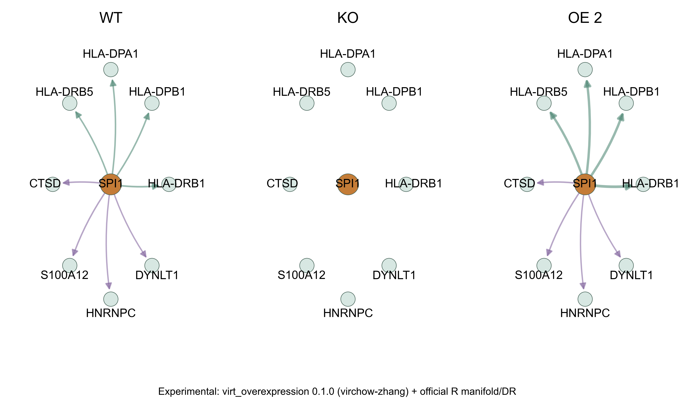 [PNG](../modules/02_scTenifoldOE/figures/OE_Figure10_Regulatory_Landscape.png) · [PDF](../modules/02_scTenifoldOE/figures/OE_Figure10_Regulatory_Landscape.pdf) · [SVG](../modules/02_scTenifoldOE/figures/OE_Figure10_Regulatory_Landscape.svg) |
| **scTour-B95-2g · B95参考模型的潜空间向量场** scTour [分析](../modules/03_scTour/scripts/run_sctour.py) · [重绘](../modules/03_scTour/scripts/plot_figure2.py) <code>& ./work/sctour/.venv/Scripts/python.exe ./modules/03_scTour/scripts/plot_figure2.py --b-path work/sctour/subsamples/B_95/inferred.h5ad --panel g --prefix B95_scTour --config modules/03_scTour/config/plot.json --output modules/03_scTour/figures/diagnostics</code> [参考来源](https://doi.org/10.1186/s13059-023-02988-9) | GSE104323 潜空间中的官方向量场流线 **PARTIAL**：真实95%训练参考模型；不是主20%设计，保留为诊断与稳定性参考。 | 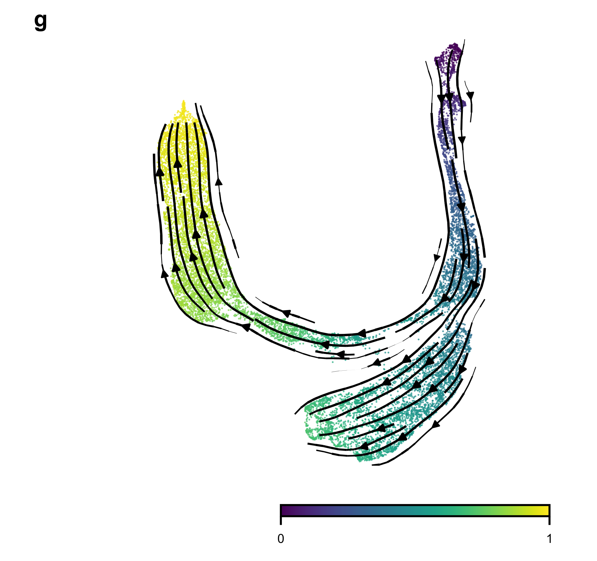 [PNG](../modules/03_scTour/figures/diagnostics/B95_scTour_Figure2g.png) · [PDF](../modules/03_scTour/figures/diagnostics/B95_scTour_Figure2g.pdf) · [SVG](../modules/03_scTour/figures/diagnostics/B95_scTour_Figure2g.svg) |
| **scTour-A90-2a · A90 seed0的非单调排序诊断** scTour [分析](../modules/03_scTour/scripts/run_sctour.py) · [重绘](../modules/03_scTour/scripts/plot_figure2.py) <code>& ./work/sctour/.venv/Scripts/python.exe ./modules/03_scTour/scripts/plot_figure2.py --a-path work/sctour/full_A/inferred.h5ad --panel a --prefix A90_seed0 --config modules/03_scTour/config/plot.json --output modules/03_scTour/figures/diagnostics</code> [参考来源](https://doi.org/10.1186/s13059-023-02988-9) | GSE95315 A90 seed0的非单调排序诊断 **PARTIAL**：完整保留真实诊断模型；A90非单调异常不可反转修复，B95为h参考，均不冒充主20%模型。 | 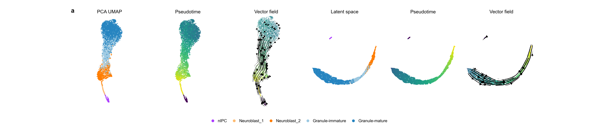 [PNG](../modules/03_scTour/figures/diagnostics/A90_seed0_Figure2a.png) · [PDF](../modules/03_scTour/figures/diagnostics/A90_seed0_Figure2a.pdf) · [SVG](../modules/03_scTour/figures/diagnostics/A90_seed0_Figure2a.svg) |
| **scTour-B95-2b · B95参考模型的原始PCA谱系** scTour [分析](../modules/03_scTour/scripts/run_sctour.py) · [重绘](../modules/03_scTour/scripts/plot_figure2.py) <code>& ./work/sctour/.venv/Scripts/python.exe ./modules/03_scTour/scripts/plot_figure2.py --b-path work/sctour/subsamples/B_95/inferred.h5ad --panel b --prefix B95_scTour --config modules/03_scTour/config/plot.json --output modules/03_scTour/figures/diagnostics</code> [参考来源](https://doi.org/10.1186/s13059-023-02988-9) | GSE104323 B95参考模型的原始PCA谱系 **PARTIAL**：完整保留真实诊断模型；A90非单调异常不可反转修复，B95为h参考，均不冒充主20%模型。 | 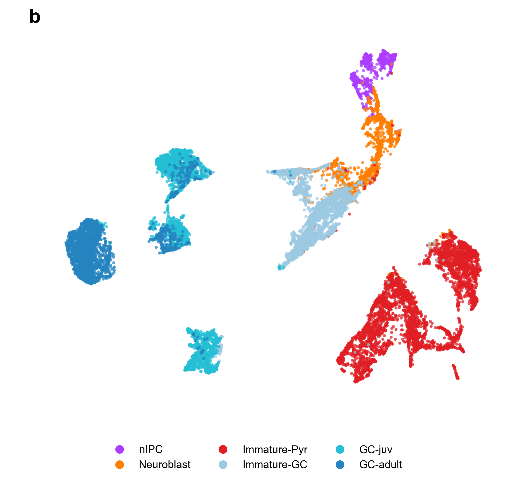 [PNG](../modules/03_scTour/figures/diagnostics/B95_scTour_Figure2b.png) · [PDF](../modules/03_scTour/figures/diagnostics/B95_scTour_Figure2b.pdf) · [SVG](../modules/03_scTour/figures/diagnostics/B95_scTour_Figure2b.svg) |
| **scTour-B95-2c · B95参考模型的批次** scTour [分析](../modules/03_scTour/scripts/run_sctour.py) · [重绘](../modules/03_scTour/scripts/plot_figure2.py) <code>& ./work/sctour/.venv/Scripts/python.exe ./modules/03_scTour/scripts/plot_figure2.py --b-path work/sctour/subsamples/B_95/inferred.h5ad --panel c --prefix B95_scTour --config modules/03_scTour/config/plot.json --output modules/03_scTour/figures/diagnostics</code> [参考来源](https://doi.org/10.1186/s13059-023-02988-9) | GSE104323 B95参考模型的批次 **PARTIAL**：完整保留真实诊断模型；A90非单调异常不可反转修复，B95为h参考，均不冒充主20%模型。 |  [PNG](../modules/03_scTour/figures/diagnostics/B95_scTour_Figure2c.png) · [PDF](../modules/03_scTour/figures/diagnostics/B95_scTour_Figure2c.pdf) · [SVG](../modules/03_scTour/figures/diagnostics/B95_scTour_Figure2c.svg) |
| **scTour-B95-2d · B95参考模型拟时序** scTour [分析](../modules/03_scTour/scripts/run_sctour.py) · [重绘](../modules/03_scTour/scripts/plot_figure2.py) <code>& ./work/sctour/.venv/Scripts/python.exe ./modules/03_scTour/scripts/plot_figure2.py --b-path work/sctour/subsamples/B_95/inferred.h5ad --panel d --prefix B95_scTour --config modules/03_scTour/config/plot.json --output modules/03_scTour/figures/diagnostics</code> [参考来源](https://doi.org/10.1186/s13059-023-02988-9) | GSE104323 B95参考模型拟时序 **PARTIAL**：完整保留真实诊断模型；A90非单调异常不可反转修复，B95为h参考，均不冒充主20%模型。 | 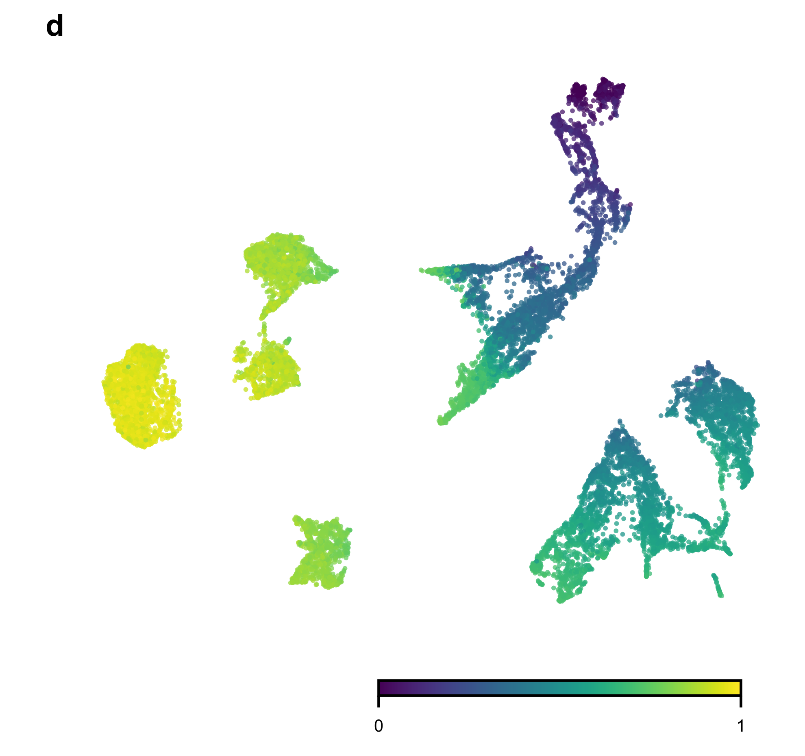 [PNG](../modules/03_scTour/figures/diagnostics/B95_scTour_Figure2d.png) · [PDF](../modules/03_scTour/figures/diagnostics/B95_scTour_Figure2d.pdf) · [SVG](../modules/03_scTour/figures/diagnostics/B95_scTour_Figure2d.svg) |
| **scTour-B95-2e · B95参考模型发育排序** scTour [分析](../modules/03_scTour/scripts/run_sctour.py) · [重绘](../modules/03_scTour/scripts/plot_figure2.py) <code>& ./work/sctour/.venv/Scripts/python.exe ./modules/03_scTour/scripts/plot_figure2.py --b-path work/sctour/subsamples/B_95/inferred.h5ad --panel e --prefix B95_scTour --config modules/03_scTour/config/plot.json --output modules/03_scTour/figures/diagnostics</code> [参考来源](https://doi.org/10.1186/s13059-023-02988-9) | GSE104323 B95参考模型发育排序 **PARTIAL**：完整保留真实诊断模型；A90非单调异常不可反转修复，B95为h参考，均不冒充主20%模型。 | 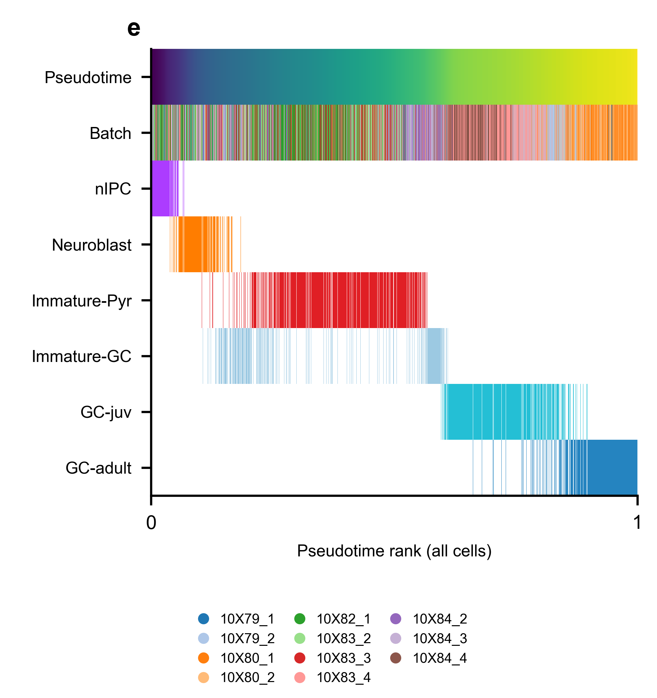 [PNG](../modules/03_scTour/figures/diagnostics/B95_scTour_Figure2e.png) · [PDF](../modules/03_scTour/figures/diagnostics/B95_scTour_Figure2e.pdf) · [SVG](../modules/03_scTour/figures/diagnostics/B95_scTour_Figure2e.svg) |
| **scTour-B95-2f · B95参考模型潜空间** scTour [分析](../modules/03_scTour/scripts/run_sctour.py) · [重绘](../modules/03_scTour/scripts/plot_figure2.py) <code>& ./work/sctour/.venv/Scripts/python.exe ./modules/03_scTour/scripts/plot_figure2.py --b-path work/sctour/subsamples/B_95/inferred.h5ad --panel f --prefix B95_scTour --config modules/03_scTour/config/plot.json --output modules/03_scTour/figures/diagnostics</code> [参考来源](https://doi.org/10.1186/s13059-023-02988-9) | GSE104323 B95参考模型潜空间 **PARTIAL**：完整保留真实诊断模型；A90非单调异常不可反转修复，B95为h参考，均不冒充主20%模型。 | 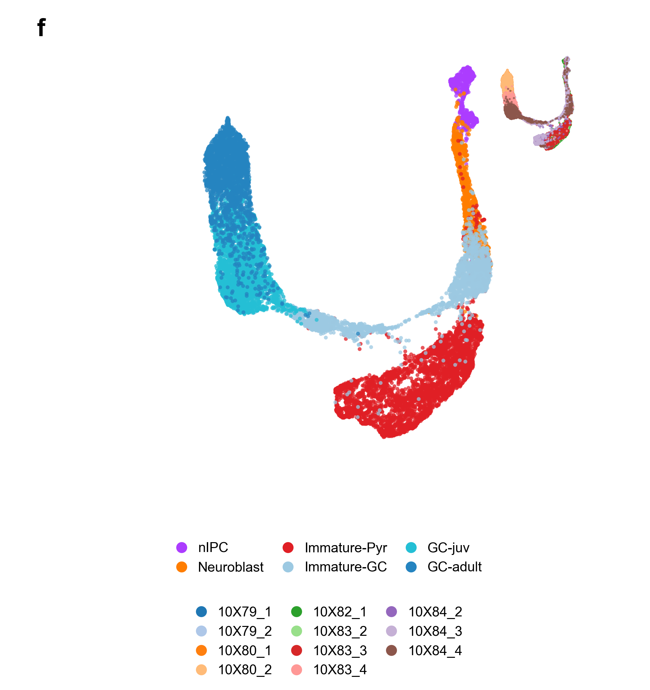 [PNG](../modules/03_scTour/figures/diagnostics/B95_scTour_Figure2f.png) · [PDF](../modules/03_scTour/figures/diagnostics/B95_scTour_Figure2f.pdf) · [SVG](../modules/03_scTour/figures/diagnostics/B95_scTour_Figure2f.svg) |
| **scTour-2b · 多分化谱系的 PCA UMAP** scTour [分析](../modules/03_scTour/scripts/run_sctour.py) · [重绘](../modules/03_scTour/scripts/plot_figure2.py) <code>& ./work/sctour/.venv/Scripts/python.exe ./modules/03_scTour/scripts/plot_figure2.py --b-path work/sctour/subsamples/B_20/inferred.h5ad --panel b --config modules/03_scTour/config/plot.json --output modules/03_scTour/figures</code> [参考来源](https://doi.org/10.1186/s13059-023-02988-9) | GSE104323 多分化谱系的 PCA UMAP **PARTIAL**：真实原始 counts、官方模型与邻域投影；训练比例与方向审查见报告，非原论文数值逐点一致。 |  [PNG](../modules/03_scTour/figures/scTour_Figure2b.png) · [PDF](../modules/03_scTour/figures/scTour_Figure2b.pdf) · [SVG](../modules/03_scTour/figures/scTour_Figure2b.svg) |
| **scTour-2d · PCA UMAP 上的发育拟时序** scTour [分析](../modules/03_scTour/scripts/run_sctour.py) · [重绘](../modules/03_scTour/scripts/plot_figure2.py) <code>& ./work/sctour/.venv/Scripts/python.exe ./modules/03_scTour/scripts/plot_figure2.py --b-path work/sctour/subsamples/B_20/inferred.h5ad --panel d --config modules/03_scTour/config/plot.json --output modules/03_scTour/figures</code> [参考来源](https://doi.org/10.1186/s13059-023-02988-9) | GSE104323 PCA UMAP 上的发育拟时序 **PARTIAL**：真实原始 counts、官方模型与邻域投影；训练比例与方向审查见报告，非原论文数值逐点一致。 | 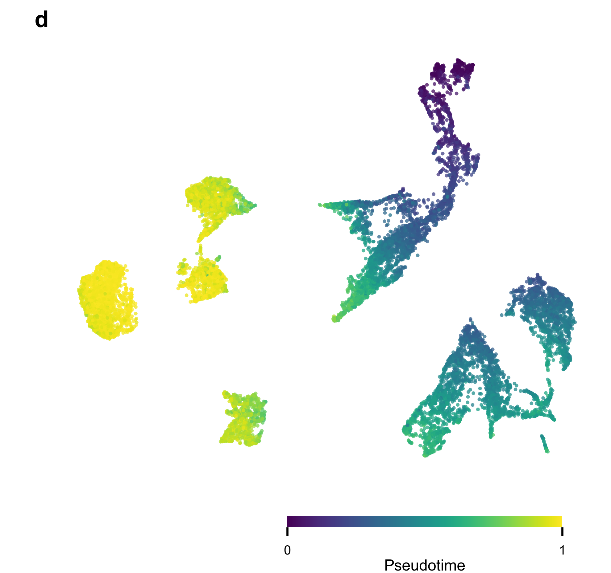 [PNG](../modules/03_scTour/figures/scTour_Figure2d.png) · [PDF](../modules/03_scTour/figures/scTour_Figure2d.pdf) · [SVG](../modules/03_scTour/figures/scTour_Figure2d.svg) |
| **scTour-2g · 潜空间中的官方向量场流线** scTour [分析](../modules/03_scTour/scripts/run_sctour.py) · [重绘](../modules/03_scTour/scripts/plot_figure2.py) <code>& ./work/sctour/.venv/Scripts/python.exe ./modules/03_scTour/scripts/plot_figure2.py --b-path work/sctour/subsamples/B_20/inferred.h5ad --panel g --config modules/03_scTour/config/plot.json --output modules/03_scTour/figures</code> [参考来源](https://doi.org/10.1186/s13059-023-02988-9) | GSE104323 潜空间中的官方向量场流线 **PARTIAL**：真实原始 counts、官方模型与邻域投影；训练比例与方向审查见报告，非原论文数值逐点一致。 | 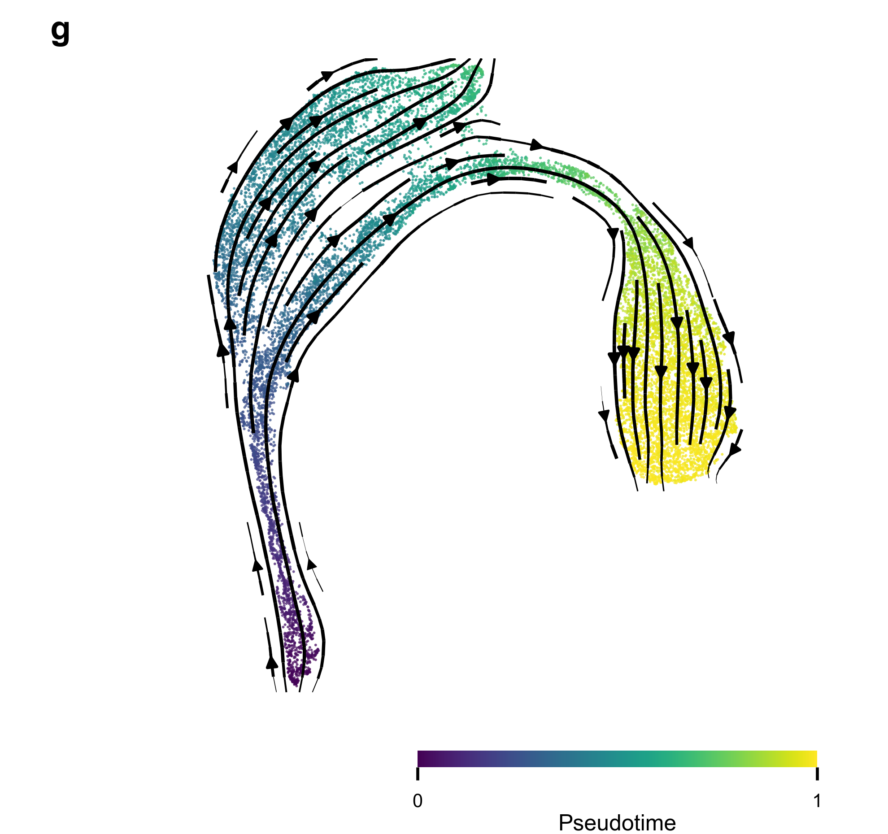 [PNG](../modules/03_scTour/figures/scTour_Figure2g.png) · [PDF](../modules/03_scTour/figures/scTour_Figure2g.pdf) · [SVG](../modules/03_scTour/figures/scTour_Figure2g.svg) |
| **scTour-2i · 20% 训练模型对完整谱系的重建** scTour [分析](../modules/03_scTour/scripts/run_sctour.py) · [重绘](../modules/03_scTour/scripts/plot_figure2.py) <code>& ./work/sctour/.venv/Scripts/python.exe ./modules/03_scTour/scripts/plot_figure2.py --subsample-dir work/sctour/subsamples --panel i --config modules/03_scTour/config/plot.json --output modules/03_scTour/figures</code> [参考来源](https://doi.org/10.1186/s13059-023-02988-9) | GSE104323 20% 训练模型对完整谱系的重建 **PARTIAL**：真实原始 counts、官方模型与邻域投影；训练比例与方向审查见报告，非原论文数值逐点一致。 | 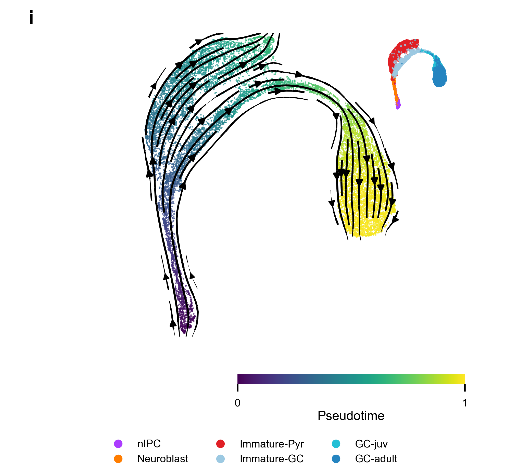 [PNG](../modules/03_scTour/figures/scTour_Figure2i.png) · [PDF](../modules/03_scTour/figures/scTour_Figure2i.pdf) · [SVG](../modules/03_scTour/figures/scTour_Figure2i.svg) |
| **scTour-2a · 单一颗粒细胞谱系：原始空间与 scTour 动力学** scTour [分析](../modules/03_scTour/scripts/run_sctour.py) · [重绘](../modules/03_scTour/scripts/plot_figure2.py) <code>& ./work/sctour/.venv/Scripts/python.exe ./modules/03_scTour/scripts/plot_figure2.py --a-path work/sctour/full_A20/inferred.h5ad --panel a --config modules/03_scTour/config/plot.json --output modules/03_scTour/figures</code> [参考来源](https://doi.org/10.1186/s13059-023-02988-9) | GSE95315 单一颗粒细胞谱系：原始空间与 scTour 动力学 **PARTIAL**：真实A模型未恢复单调的颗粒细胞成熟顺序，异常完整保留；不能将该面板解释为发育趋势复现成功。 | 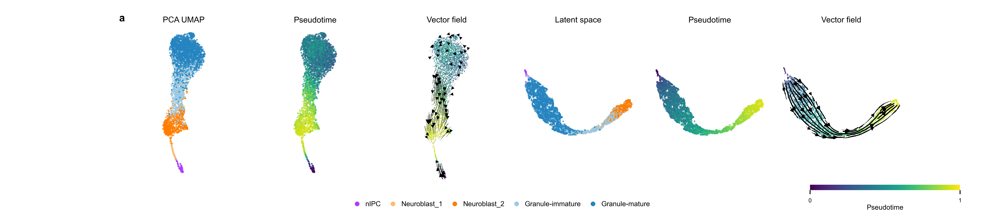 [PNG](../modules/03_scTour/figures/scTour_Figure2a.png) · [PDF](../modules/03_scTour/figures/scTour_Figure2a.pdf) · [SVG](../modules/03_scTour/figures/scTour_Figure2a.svg) |
| **scTour-2c · 相同 PCA UMAP 上的样本批次** scTour [分析](../modules/03_scTour/scripts/run_sctour.py) · [重绘](../modules/03_scTour/scripts/plot_figure2.py) <code>& ./work/sctour/.venv/Scripts/python.exe ./modules/03_scTour/scripts/plot_figure2.py --b-path work/sctour/subsamples/B_20/inferred.h5ad --panel c --config modules/03_scTour/config/plot.json --output modules/03_scTour/figures</code> [参考来源](https://doi.org/10.1186/s13059-023-02988-9) | GSE104323 相同 PCA UMAP 上的样本批次 **PARTIAL**：真实原始 counts、官方模型与邻域投影；训练比例与方向审查见报告，非原论文数值逐点一致。 | 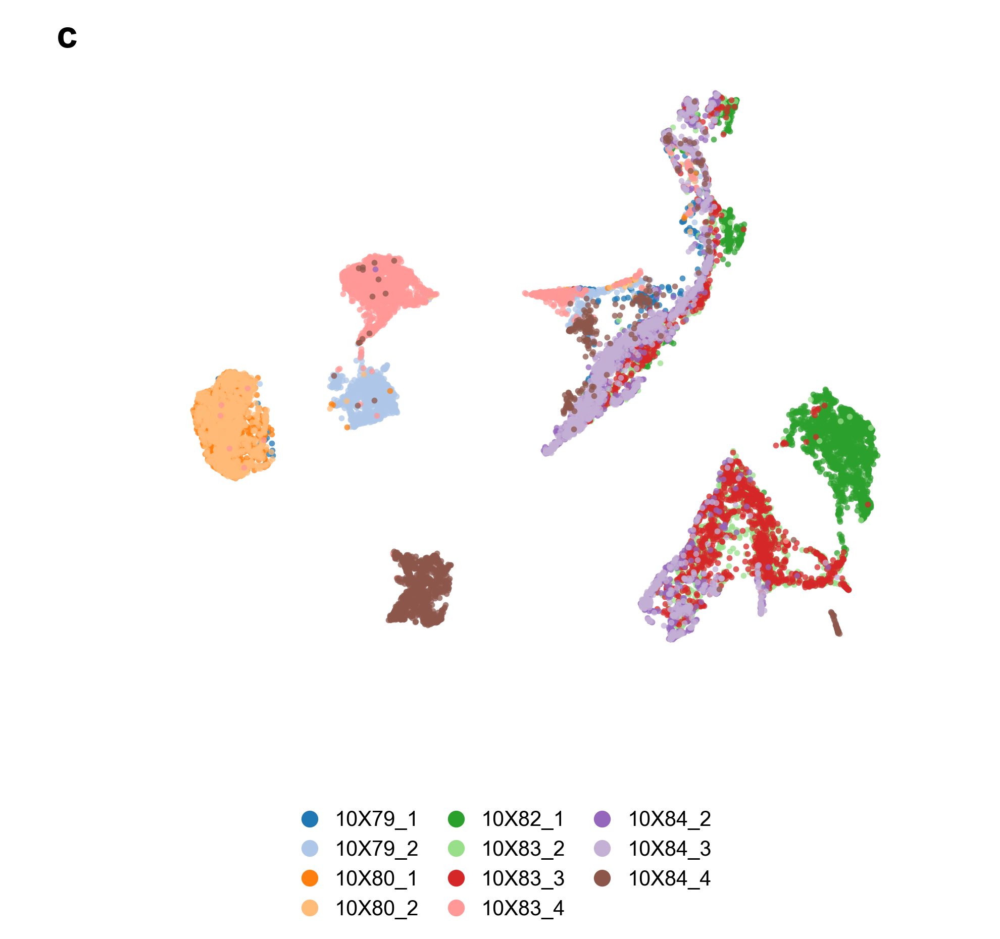 [PNG](../modules/03_scTour/figures/scTour_Figure2c.png) · [PDF](../modules/03_scTour/figures/scTour_Figure2c.pdf) · [SVG](../modules/03_scTour/figures/scTour_Figure2c.svg) |
| **scTour-2e · 拟时序排序及批次和细胞类型** scTour [分析](../modules/03_scTour/scripts/run_sctour.py) · [重绘](../modules/03_scTour/scripts/plot_figure2.py) <code>& ./work/sctour/.venv/Scripts/python.exe ./modules/03_scTour/scripts/plot_figure2.py --b-path work/sctour/subsamples/B_20/inferred.h5ad --panel e --config modules/03_scTour/config/plot.json --output modules/03_scTour/figures</code> [参考来源](https://doi.org/10.1186/s13059-023-02988-9) | GSE104323 拟时序排序及批次和细胞类型 **PARTIAL**：真实原始 counts、官方模型与邻域投影；训练比例与方向审查见报告，非原论文数值逐点一致。 | 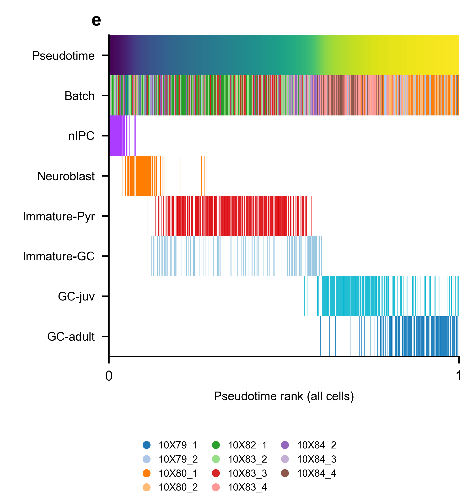 [PNG](../modules/03_scTour/figures/scTour_Figure2e.png) · [PDF](../modules/03_scTour/figures/scTour_Figure2e.pdf) · [SVG](../modules/03_scTour/figures/scTour_Figure2e.svg) |
| **scTour-2f · scTour 潜空间及批次 inset** scTour [分析](../modules/03_scTour/scripts/run_sctour.py) · [重绘](../modules/03_scTour/scripts/plot_figure2.py) <code>& ./work/sctour/.venv/Scripts/python.exe ./modules/03_scTour/scripts/plot_figure2.py --b-path work/sctour/subsamples/B_20/inferred.h5ad --panel f --config modules/03_scTour/config/plot.json --output modules/03_scTour/figures</code> [参考来源](https://doi.org/10.1186/s13059-023-02988-9) | GSE104323 scTour 潜空间及批次 inset **PARTIAL**：真实原始 counts、官方模型与邻域投影；训练比例与方向审查见报告，非原论文数值逐点一致。 | 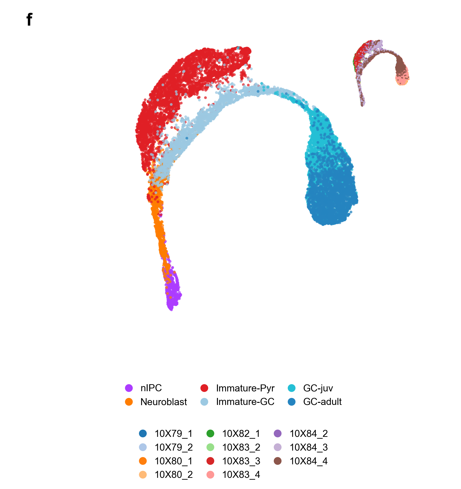 [PNG](../modules/03_scTour/figures/scTour_Figure2f.png) · [PDF](../modules/03_scTour/figures/scTour_Figure2f.pdf) · [SVG](../modules/03_scTour/figures/scTour_Figure2f.svg) |
